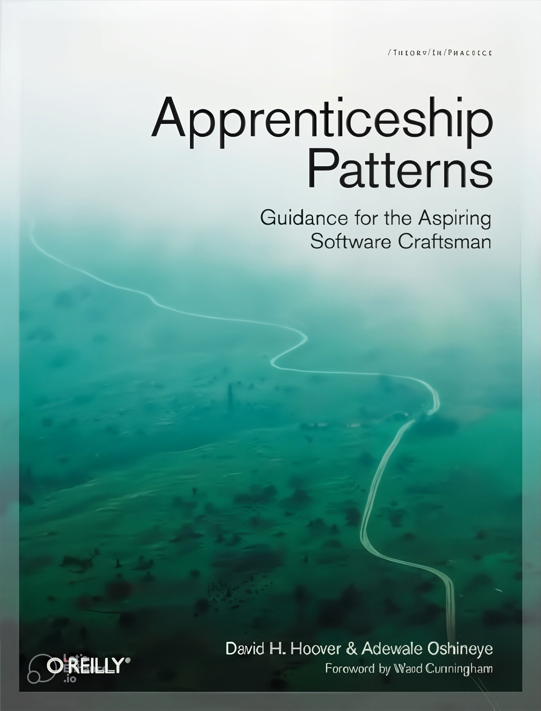

  

<h1 align="center">🚀 ترجمه جامع و آزاد کتاب Apprenticeship Patterns</h1>

  <strong>الگوهای رشد، کارآموزی و استادکاری در مسیر حرفه‌ای شدن مهندسان نرم‌افزار؛ ویژه برنامه‌نویسان فارسی‌زبان</strong>

  

  

  

  

  

---

## 💡 چرا این پروژه؟

کتاب **Apprenticeship Patterns: Guidance for the Aspiring Software Craftsman** نوشته‌ی *دیو هوور (Dave Hoover)* و *ادوال اوشینیه (Adewale Oshineye)* از انتشارات O'Reilly، یکی از ارزشمندترین راهنماها برای تبدیل‌شدن از یک برنامه‌نویس تازه‌کار به یک **صنعتگر و مهندس نرم‌افزار حرفه‌ای** است.

هدف ما در این پروژه اوپن‌سورس:
* 🎯 **ترجمه‌ای روان، دقیق و کاربردی** برای انتقال درست نگرش شاگردی و یادگیری مستمر
* 💻 **ارائه رایگان الگوهای عملی رشد شغلی** از «خالی کردن فنجان» تا ساخت برنامه یادگیری شخصی
* 🌍 **غنی‌سازی منابع فارسی** برای ارتقای کیفیت حرفه‌ای جامعه توسعه‌دهندگان

---

  ## ⚡ دسترسی سریع

| مرجع | توضیحات | لینک |
| :--- | :--- | :---: |
| 📖 **نسخه وب (گیتاب)** | تجربه خواندن تعاملی با پوسته تاریک/روشن و جستجوی سریع | [ورود به گیتاب ↗](https://hheydarian.github.io/Gitab/books/book6/) |
| 📥 **فصل‌های کتاب (Markdown)** | مشاهده و مطالعه مستقیم فایل‌های فارسی در پوشه فصل‌ها | [مشاهده پوشه Book ↗](Book/) |

---

## 🔍 راهنمای خوانایی بهتر در گیت‌هاب

برای اینکه متون فارسی در گیت‌هاب و مرورگر با خط استاندارد و چشم‌نواز نمایش داده شوند:
1. افزونه رایگان **[فونت ایران (FontIran)](https://chromewebstore.google.com/detail/fontiran/edbchgkbejkdkdkpgenlaciegoidmjoh)** را روی مرورگر نصب کنید.
2. فونت پیش‌فرض را روی **وزیرمتن (Vazirmatn)** یا **ایران‌یکان** قرار دهید تا خوانایی کدها و متن به اوج برسد.

---

## 📚 فهرست سرفصل‌ها

تمامی **۱۲ سرفصل و ضمیمه** کتاب به طور کامل ترجمه شده و آماده مطالعه است:

| شماره | نام سرفصل (انگلیسی) | عنوان فارسی | وضعیت | مطالعه مستقیم |
| :---: | :--- | :--- | :---: | :---: |
| **00** | Preface | پیش‌گفتار | ✅ | [مطالعه فصل](Book/00/Preface.md) |
| **01** | Introduction | مقدمه | ✅ | [مطالعه فصل](Book/01/Introduction.md) |
| **02** | Emptying the Cup | خالی کردن فنجان | ✅ | [مطالعه فصل](Book/02/Emptying-the-Cup.md) |
| **03** | Walking the Long Road | پیمودن مسیر طولانی | ✅ | [مطالعه فصل](Book/03/Walking-the-Long-Road.md) |
| **04** | Accurate Self-Assessment | ارزیابی دقیق خود | ✅ | [مطالعه فصل](Book/04/Accurate-Self-Assessment.md) |
| **05** | Perpetual Learning | یادگیری مداوم و همیشگی | ✅ | [مطالعه فصل](Book/05/Perpetual-Learning.md) |
| **06** | Construct Your Curriculum | برنامه درسی خود را بسازید | ✅ | [مطالعه فصل](Book/06/Construct-Your-Curriculum.md) |
| **07** | Conclusion | نتیجه‌گیری | ✅ | [مطالعه فصل](Book/07/Conclusion.md) |
| **A** | Pattern List | ضمیمه A: فهرست الگوها | ✅ | [مطالعه فصل](Book/APPENDIX-A/Pattern-List.md) |
| **B** | A Call for Apprenticeship | ضمیمه B: فراخوانی برای شاگردی | ✅ | [مطالعه فصل](Book/APPENDIX-B/A-Call-for-Apprenticeship.md) |
| **C** | A Retrospective on the First Year | ضمیمه C: نگاهی به سال اول | ✅ | [مطالعه فصل](Book/APPENDIX-C/A-Retrospective-on-the-First-Year.md) |
| **D** | Online Resources | ضمیمه D: منابع آنلاین | ✅ | [مطالعه فصل](Book/APPENDIX-D/Online-Resources.md) |

---

## 🤝 مشارکت در پروژه (Contributions Welcome)

این یک پروژه اجتماعی متعلق به تمام توسعه‌دهندگان و علاقه‌مندان است. هر تصحیح نگارشی، بهبود در واژه‌گزینی‌های تخصصی یا بهینه‌سازی ساختار متن، ارزش این منبع را دوچندان می‌کند:

1. **فورک کنید (Fork):** ریپازیتوری را فورک کرده و یک برنچ جدید بسازید (`git checkout -b feature/edit-chapter-01`).
2. **اصلاح و بازبینی:** متن یا بخش‌های مورد نظر را اصلاح کنید.
3. **کامیت و ارسال:** تغییرات را ثبت کرده و یک Pull Request تمیز ارسال فرمایید.

> اگر سوال، ابهام یا پیشنهادی درباره مطالب یا ترجمه دارید، خوشحال می‌شویم آن را از طریق بخش **[Issues](https://github.com/hheydarian/apprenticeship-patterns-persian/issues)** مطرح کنید.

---

## ⚖️ مجوز و حقوق مالکیت معنوی

* **کتاب اصلی:** حقوق نشر و مادی/معنوی اثر اصلی متعلق به **Dave Hoover**، **Adewale Oshineye** و انتشارات **O'Reilly Media** است.
* **متن ترجمه فارسی:** متن ترجمه شده تحت لایسنس بین‌المللی **[CC BY-NC-SA 4.0](https://creativecommons.org/licenses/by-nc-sa/4.0/)** (استفاده غیرتجاری با ذکر منبع و اشتراک‌گذاری با همان شرایط) منتشر می‌شود.
* **فایل‌های مخزن:** در دسترس تحت مجوز **MIT License** (مطابق فایل [LICENSE](LICENSE)).

---

  ⭐ <strong>اگر این ترجمه و ریپازیتوری به مسیر شغلی شما کمک کرده، با دادن یک ستاره (Star) به دیده شدنش توسط دیگران کمک کنید!</strong> ⭐

  ساخته شده با ❤️ و عشق به توسعه‌دهندگان فارسی‌زبان

